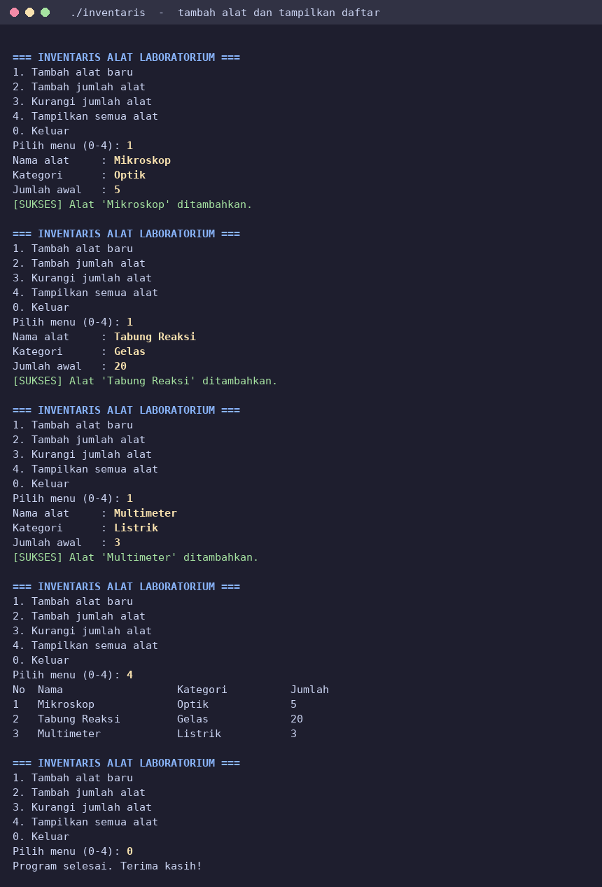

# Inventaris Alat Laboratorium (Praktikum OOP C++ - Bab 8.3)

## Deskripsi Program
Program konsol C++ untuk mencatat alat laboratorium sekolah (mikroskop, tabung reaksi, multimeter, dan sebagainya). Program menerapkan konsep class, object, constructor, encapsulation, dan method. Seluruh alat disimpan dalam `std::vector<AlatLaboratorium>`.

Fitur menu:
1. Tambah alat baru
2. Tambah jumlah alat yang sudah terdaftar
3. Kurangi jumlah alat yang sudah terdaftar
4. Tampilkan semua alat
0. Keluar

## Cara Menjalankan
Dibutuhkan `g++` yang mendukung C++17 dan `make`.

```bash
make            # kompilasi, menghasilkan file ./inventaris
./inventaris    # jalankan program
make test       # jalankan 15 uji otomatis (tests/uji_manual.sh)
make clean      # hapus hasil kompilasi
```

Tanpa make:

```bash
g++ -std=c++17 -Wall -Wextra -pedantic src/main.cpp src/AlatLaboratorium.cpp -o inventaris
```

## Struktur Folder
```text
src/
  AlatLaboratorium.hpp   deklarasi kelas
  AlatLaboratorium.cpp   implementasi method
  main.cpp               koleksi objek (vector) dan menu
docs/
  class_diagram.png
  flowchart.png
  screenshot_tambah_dan_tampilkan.png
  screenshot_ubah_jumlah.png
tests/
  uji_manual.sh          skenario uji berbasis input
Makefile
README.md
```

## Penjelasan Kelas dan Method

Kelas `AlatLaboratorium` memiliki tiga atribut private (encapsulation): `nama` (string), `kategori` (string), `jumlah` (int). Atribut hanya dapat dibaca lewat getter dan diubah lewat method.

| Method | Fungsi |
|---|---|
| `AlatLaboratorium(nama, kategori, jumlah)` | Constructor, mengisi ketiga atribut. Jumlah awal negatif dijadikan 0. |
| `getNama()`, `getKategori()`, `getJumlah()` | Getter untuk membaca atribut private. |
| `tampilkanInfo()` | Mencetak satu baris informasi alat. |
| `tambahJumlah(int n)` | Menambah jumlah. Mengembalikan `false` jika `n <= 0` atau hasilnya melebihi batas `int`. |
| `kurangiJumlah(int n)` | Mengurangi jumlah. Mengembalikan `false` jika `n <= 0` atau `n` lebih besar dari jumlah saat ini, sehingga jumlah tidak pernah negatif. |

Method mengembalikan `bool` (berhasil atau tidak), sedangkan pesan ke pengguna dicetak oleh `main.cpp`.

## Aturan Penanganan Input
- Semua input angka dibaca sebagai teks lalu diperiksa. Huruf, desimal (misal `2.5`), dan input kosong ditolak dengan pesan, program tidak berhenti.
- Jumlah awal negatif ditolak. Jumlah tambahan dan pengurangan harus lebih dari 0.
- Pengurangan lebih besar dari jumlah saat ini ditolak, jadi jumlah tidak bisa negatif.
- Nama dan kategori tidak boleh kosong. Spasi di awal dan akhir dihapus.

## Aturan Alat Duplikat
Dua alat dianggap sama jika nama dan kategorinya sama, dengan huruf besar/kecil diabaikan (`Mikroskop`/`Optik` sama dengan `  mikroskop `/`OPTIK`). Menambah alat yang sudah ada ditolak, dan pengguna diarahkan ke menu tambah jumlah. Nama sama tetapi kategori berbeda dianggap alat lain. Aturan ini dipilih karena sederhana dan mencegah dua baris untuk alat yang sama.

## Pengujian
Perintah yang dijalankan: `make` (tanpa warning dengan `-Wall -Wextra -pedantic`), lalu `make test`.

Hasil `make test`: 15 dari 15 uji lulus.

| Uji | Yang diperiksa |
|---|---|
| T1 | Tambah alat lalu tampilkan |
| T2, T3 | Tambah dan kurangi jumlah |
| T4 | Pengurangan melebihi jumlah ditolak, jumlah tidak negatif |
| T5 | Jumlah awal negatif ditolak |
| T6, T7 | Input huruf dan desimal ditolak |
| T8, T9 | Duplikat (abaikan huruf besar/kecil) ditolak, kategori beda diterima |
| T10 | Tambah jumlah 0 atau negatif ditolak |
| T11 | Nomor alat tidak valid |
| T12 | Menu bukan angka dan menu tidak tersedia |
| T13 | Ubah jumlah saat daftar kosong |
| T14 | Input habis (EOF) tidak membuat program menggantung |
| T15 | Penambahan melebihi batas `int` ditolak |

Program juga dijalankan sekali dengan AddressSanitizer dan UBSan (`-fsanitize=address,undefined`) pada skenario tambah, ubah, dan tampilkan, tanpa temuan.

## Diagram
- Diagram kelas: `docs/class_diagram.png`
- Flowchart menu: `docs/flowchart.png`

## Screenshot Output
Tambah alat dan tampilkan daftar:



Ubah jumlah, penolakan input, dan alat duplikat:


