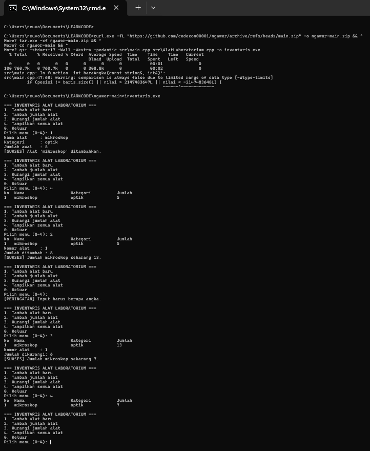

# Inventaris Alat Laboratorium

Kami membuat program ini untuk Praktikum OOP C++ Bab 8.3. Lewat menu di terminal, pengguna bisa menambah alat, mengubah jumlahnya, dan melihat daftar alat yang sudah dicatat. Data disimpan selama program berjalan.

## Cara menjalankan

Buka CMD di folder proyek. Pastikan `g++` sudah tersedia, lalu jalankan:

```cmd
g++ -std=c++17 -Wall -Wextra -pedantic src\main.cpp src\AlatLaboratorium.cpp -o inventaris.exe
inventaris.exe
```

Di Linux, jalankan `make` lalu `./inventaris`.

## Contoh penggunaan di Windows CMD

Mikroskop ditambahkan dengan jumlah awal 5, lalu muncul di daftar alat.


Pada sesi yang sama, jumlah mikroskop ditambah 8 menjadi 13, lalu dikurangi 6. Tabel terakhir menunjukkan jumlah 7.



## Cara kerja program

`main.cpp` mengatur menu, memeriksa input, dan menyimpan daftar alat dalam `std::vector<AlatLaboratorium>`. Nama dan kategori dipakai untuk mengecek duplikat tanpa membedakan huruf besar dan kecil. Kalau alatnya sudah ada, jumlahnya bisa diubah lewat menu.

Kelas `AlatLaboratorium` menyimpan nama, kategori, dan jumlah sebagai atribut privat. Konstruktor mengisi data awal. Metode `tampilkanInfo()` mencetak data alat, sedangkan `tambahJumlah()` dan `kurangiJumlah()` mengembalikan `true` jika perubahan berhasil. Pengurangan yang melebihi jumlah tersedia ditolak.

## Struktur proyek

| Lokasi | Isi |
|---|---|
| `src/main.cpp` | Menu, input, dan daftar alat |
| `src/AlatLaboratorium.hpp` | Deklarasi kelas |
| `src/AlatLaboratorium.cpp` | Implementasi konstruktor dan metode |
| `docs/` | Diagram dan screenshot CMD |
| `tests/` | Skrip pengujian |

## Diagram

| Diagram | Isi |
|---|---|
| [Alur sistem](docs/fullsys.png) | Menu, validasi, dan alur setiap pilihan |
| [Alur main.cpp](docs/flowchart_main.png) | Percabangan menu |
| [Alur AlatLaboratorium.cpp](docs/flowchart_alat_laboratorium_cpp.png) | Konstruktor dan metode |
| [Diagram kelas](docs/class_diagram.png) | Atribut dan deklarasi metode |

Alur detail tersedia untuk [tambah alat](docs/flowchart_main_tambah_alat.png), [ubah jumlah](docs/flowchart_main_ubah_jumlah.png), [tampilkan daftar](docs/flowchart_main_tampilkan_daftar.png), dan [baca input](docs/flowchart_main_input.png).

## Pengujian

Jalankan `make test` di Linux. Pada pengujian terakhir, 15 dari 15 skenario lulus. Skenarionya ada di [uji_manual.sh](tests/uji_manual.sh).
